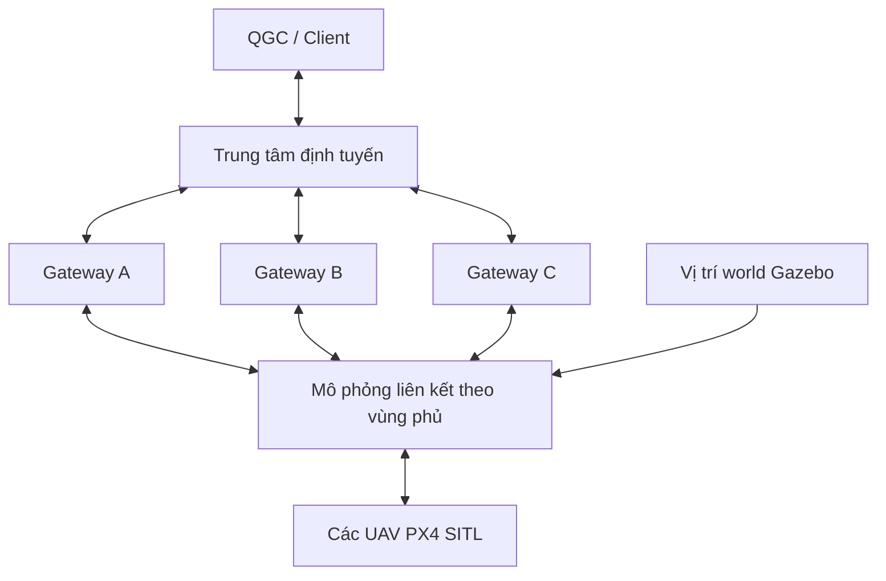

# Hệ thống gateway phân vùng cho nhiều UAV PX4

Tài liệu thiết kế và lộ trình triển khai, cập nhật 21/11/2026.

> Hiện trạng được đối chiếu với bản mã nguồn PBL3project(1).rar đã gửi trong cuộc trò chuyện. Đây không phải xác nhận mã trên máy bạn đã có những thay đổi mới hơn. Các tên module, giao thức và cấu hình ghi “đề xuất” dưới đây cần lập trình thêm.

## 1. Mục tiêu và phạm vi

Mô phỏng nhiều UAV PX4 SITL trong cùng thế giới Gazebo, hoạt động qua ba gateway A/B/C. Khi UAV di chuyển, hệ thống tự cập nhật gateway phục vụ, trong khi QGroundControl/client vẫn giữ đầu kết nối tới trung tâm.

Trọng tâm là định tuyến MAVLink, mô phỏng vùng phủ và chuyển vùng. Hoàn thiện một UAV trước, sau đó thử ba UAV. Không cần bay đội hình hoặc đồng bộ cất cánh tuyệt đối. Mục tiêu là giảm gián đoạn, không cam kết không mất khung trong mọi điều kiện. Khi ra ngoài toàn bộ vùng phủ, phải báo mất liên lạc thật.

## 2. Kiến trúc đích



- PX4 thực hiện điều khiển bay, tạo telemetry và ACK.
- Gazebo mô phỏng chuyển động và cung cấp vị trí world.
- Bộ mô phỏng liên kết kiểm soát cả telemetry và lệnh trên từng cặp UAV–gateway.
- Gateway nhận khung, kiểm CRC, quản lý endpoint và chuyển tiếp.
- Trung tâm quản lý các đường ứng viên, chọn gateway chính, giữ quyền điều khiển và kết nối client.
- QGC chọn UAV theo SYSID và gửi lệnh qua trung tâm.

Ba trạm trong Gazebo chỉ là mô hình hiển thị. Ba gateway là ba tiến trình mạng. Mạng không tự đổi chỉ vì UAV bay qua hình vùng phủ.

## 3. Phần đã có

| Thành phần | Khả năng hiện có | Cách dùng lại |
|---|---|---|
| MAVLink codec | v1/v2, CRC, chia/gộp khung | Giữ tại gateway và trung tâm khi cần phân tích lệnh |
| Quản lý UAV | Nhận diện SYSID, học endpoint UDP, online/offline | Mở rộng quản lý nhiều đường |
| Định tuyến | Gửi về UAV đích trong một gateway | Là nền cho định tuyến qua gateway vùng |
| Fanout | Chuyển telemetry tới nhiều TCP client | Tái sử dụng tại trung tâm |
| Client manager | Gửi không chặn, hàng đợi riêng, client chậm | Giữ để cô lập kết nối |
| Queue UDP | Có giới hạn, kiểm đường và dọn dữ liệu cũ | Mở rộng với gateway và epoch |
| Điều khiển | Khóa quyền, lệnh văn bản, ACK/retry; chuyển MAVLink QGC | Tách quản lý giao dịch khỏi đường truyền |
| Telemetry | Giải mã trạng thái, pin, GPS, vị trí, góc | Dùng cho giám sát |
| Công cụ thử | UAV giả, probe, kiểm parser, sequence, tải client | Giữ làm kiểm thử hồi quy |

### 3.1 Bằng chứng đã có trong các lượt thử

- Dữ liệu tổng hợp: 200/200 khung v1/v2 hợp lệ; phát hiện 88/88 lỗi lật bit được thử; 10.000/10.000 khung liên tục nhận đúng.
- UAV giả: 6/6 ca giải mã và 11/11 ca sequence đạt.
- PX4 SITL: hai UAV được nhận diện; UAV 1 tiếp tục có ACK khi UAV 2 offline; UAV 2 xuất hiện ở endpoint mới và có ACK.
- 20/20 kết nối TCP mới nhận ACK lệnh yêu cầu bản tin, không phải 20 lần cất cánh.
- Một UAV, một client, 600 giây: gateway ingress/egress đều 34.074 khung, trung bình 56,79 khung/s.
- Tải 1/5/10 client trong 600 giây: trung bình mỗi client khoảng 56,64 / 56,56 / 56,80 khung/s, không client nào bị ngắt trong ba lượt đó.

Đây là kết quả lịch sử theo phiên bản đã đo. Không coi là chứng nhận bản đa gateway. Cửa sổ gateway và client khởi động riêng nên không lấy chênh tổng khung làm tỷ lệ mất.

## 4. Phần phải sửa trong mã hiện tại

### 4.1 Một UAV mới có một endpoint

Trong `src/gateway/uav_manager.h`, cấu trúc UAV lưu một địa chỉ UDP. Heartbeat cùng SYSID từ endpoint khác khi UAV còn online bị coi là CONFLICT. Nếu gom ba gateway theo cách này, đường ứng viên có thể bị từ chối.

Giữ cơ chế chống SYSID trùng ở gateway vùng. Tại trung tâm, quản lý danh tính UAV độc lập với danh tính đường: một SYSID có thể có đường qua A và B đồng thời. Đường phải có gateway_id và session_id; không tự kết luận hai nguồn trùng SYSID là cùng UAV khi chưa có cấu hình nhận diện tin cậy.

### 4.2 Timeout không phải chuyển vùng

Timeout route hiện tại là 5 giây. Chờ A hết hạn rồi học B là phục hồi sau mất liên lạc. Chuyển vùng cần chuẩn bị B trong khi A còn hoạt động. Không chỉ giảm timeout rồi gọi đó là handover.

### 4.3 Lệnh chờ gắn với generation

Trong `src/gateway/gateway.cpp`, lệnh văn bản đang chờ và việc ghép ACK gắn với generation của route. Đổi generation có thể làm lệnh trả OFFLINE hoặc ACK không ghép được.

Đưa giao dịch lệnh do client văn bản tạo về trung tâm. Đổi gateway không tự hủy giao dịch. Với QGC, chuyển nguyên khung và để QGC quản lý giao dịch/retry của nó. Không thêm một vòng retry độc lập tại mỗi gateway.

### 4.4 Quyền điều khiển còn cục bộ

`controller_` là socket tại từng gateway. Cần thống nhất quyền ở trung tâm. Bản đầu dùng một client điều khiển, các client khác chỉ giám sát; khi mở rộng có thể cấp quyền theo UAV. Gateway vùng phải chỉ nhận lệnh từ liên kết trung tâm được cấu hình, tránh client kết nối trực tiếp làm đường tắt.

### 4.5 Tránh sửa nhầm bản mã

Có file trùng tên trực tiếp trong `src/` và trong các thư mục con. `build.bat` đang build `src/gateway/gateway.cpp`, không phải `src/gateway.cpp`. Kiểm tra tham chiếu build trước khi dọn mã cũ.

## 5. Các module còn thiếu

| Module đề xuất | Đầu vào | Đầu ra / trách nhiệm |
|---|---|---|
| gazebo_pose_reader | Pose world của từng model | model, SYSID, x/y/z, thời điểm |
| coverage_simulator | Pose và cấu hình ba vùng | Đường truyền hai chiều có/không khả dụng |
| regional_gateway | UDP UAV, liên kết trung tâm | MAVLink và trạng thái đường theo gateway_id |
| central_router | Ba liên kết gateway, QGC/client | Chọn đường theo target_system |
| route_registry | Báo đường và hết hạn | Các đường ứng viên cho mỗi SYSID |
| handover_manager | Đường, chất lượng, timer | Chọn gateway chính, tăng epoch |
| deduplicator | Khung telemetry từ nhiều gateway | Một bản hợp lệ trong cửa sổ lọc |
| command_manager | Lệnh văn bản, ACK, timeout | Giao dịch lệnh xuyên đường |
| event_logger | Route, frame, command, pose | Log đo chuyển vùng có thể đối soát |

## 6. Cấu hình mô phỏng đề xuất

### 6.1 Ba vùng

| Gateway | Tâm world (m) | Bán kính |
|---|---|---|
| A | (0, 0) | 40 m |
| B | (60, 0) | 40 m |
| C | (120, 0) | 40 m |

Điều kiện 2D: `(x-x_i)^2 + (y-y_i)^2 <= 1600`.

Dọc y=0, vùng giao A–B là x=20–40 m, B–C là x=80–100 m. Vị trí cần lấy theo world Gazebo, không lấy local NED của các PX4 rồi so trực tiếp. Khai báo ánh xạ model–SYSID rõ ràng. Độ cao chưa ảnh hưởng vùng phủ ở phiên bản này.

### 6.2 Cổng chạy cùng máy (đề xuất, chưa phải cấu hình có sẵn)

| Liên kết | Cổng |
|---|---|
| PX4 UAV 1/2/3 gửi tới simulator | UDP 14600/14601/14602 |
| Simulator gửi tới gateway A/B/C | UDP 14550/14560/14570 |
| Trung tâm kết nối gateway A/B/C | TCP 5761/5762/5763 |
| QGC kết nối trung tâm | TCP 5760 |

Gateway hiện có tham số UDP/TCP port, nhưng kết nối liên gateway cần bổ sung. PX4 và simulator phải dùng endpoint hai chiều nhất quán. Đối với mỗi cặp UAV–gateway, simulator nên có socket nguồn riêng ổn định để trả lệnh về đúng UAV. Kiểm tra bind trước khi chạy.

Simulator không được đưa telemetry thẳng về trung tâm hoặc cho lệnh đi tắt tới UAV. Ngắt mọi đường QGC–PX4 trực tiếp trong phép thử để kết quả thật sự đi qua hệ thống.

## 7. Giao thức gateway–trung tâm đề xuất

Dùng một kết nối TCP hai chiều cho mỗi gateway. Không trộn JSON dòng tùy ý với MAVLink thô mà thiếu framing. Đề xuất envelope: độ dài, loại bản tin, payload. Giới hạn kích thước, tích lũy TCP stream đúng cách, xử lý reconnect và backpressure.

Các loại bản tin cần có:

- HELLO: gateway_id, session_id mới mỗi lần tiến trình khởi động.
- ROUTE_REPORT: SYSID/COMPID, trạng thái đường, tuổi dữ liệu, chất lượng nếu có.
- MAVLINK_UP: gateway_id, danh tính đường, khung MAVLink gốc và thời điểm nhận.
- MAVLINK_DOWN: UAV đích, gateway được chọn, epoch, thời hạn dùng và khung gốc.
- ROUTE_COMMIT: chuyển quyền phát lệnh sang gateway mới, có xác nhận.
- KEEPALIVE: theo dõi kết nối gateway–trung tâm, độc lập HEARTBEAT UAV.

Các tên trên là giao thức riêng của dự án, không phải bản tin chuẩn MAVLink. Không sửa SYSID hoặc nội dung MAVLink khi chỉ đóng gói vận chuyển. Không phát HEARTBEAT giả như UAV để che mất liên lạc.

## 8. Dữ liệu và thuật toán chuyển vùng

Mỗi UAV tại trung tâm cần lưu: SYSID, gateway chính, danh sách đường, last_seen, gateway_session, epoch, ứng viên, candidate_since và trạng thái lệnh. Mỗi đường có tình trạng uplink/downlink và thời điểm xác nhận. Nhận telemetry chỉ chứng minh uplink, chưa đủ xác nhận hai chiều.

### 8.1 Chọn đường

Phiên bản đầu dùng điểm khoảng cách, ví dụ `score = 1 - d/40` cho đường trong vùng. Đây là điểm mô phỏng, không gọi là RSSI. Có thể bổ sung tuổi dữ liệu và probe hai chiều.

Ví dụ tham số khởi đầu: kiểm tra mỗi 100 ms, H=0,10 theo điểm chuẩn hóa, T=0,5 s. Đây chỉ là giá trị thử ban đầu. Chọn theo tốc độ bay và thời gian còn trong vùng giao, không coi là thông số tối ưu.

1. Giữ A khi A hợp lệ và chưa có ứng viên tốt hơn đủ lâu.
2. B có đường hai chiều, tốt hơn A ít nhất H liên tục trong T thì chuẩn bị B.
3. Xác nhận B sẵn sàng, tăng epoch và chuyển gateway chính.
4. Ngừng phát lệnh mới qua A, hủy khung chưa gửi trên A. Duy trì tiếp nhận ACK đã phát qua A trong cửa sổ chuyển tiếp có giới hạn.
5. Nhận telemetry qua A/B và loại bản sao, sau đó kết thúc đường cũ.
6. Nếu A mất đột ngột, dùng ứng viên đã sẵn sàng; không chờ điều kiện “tốt hơn A” vô nghĩa. Không có đường thì LOST, không phát dữ liệu giả.

Đặt timeouts theo thời gian thực monotonic cho mạng. Pose dùng thời gian mô phỏng có thể dừng/reset, nên phải xử lý pause/reset rõ ràng và hết hạn dữ liệu.

### 8.2 Chống trùng và điều khiển cũ

Không dùng sequence 8 bit một mình để loại trùng. Có thể dùng hash toàn bộ khung gốc cùng SYSID/COMPID trong cửa sổ ngắn, tính tới wrap/restart và khung hợp lệ lặp. Lệnh và ACK không đi qua bộ lọc telemetry một cách mù quáng. Không gửi một lệnh đồng thời qua A và B. Joystick/setpoint phải có thời hạn ngắn; hết hạn thì bỏ, không phát lại sau reconnect.

MAVLink COMMAND_ACK không có transaction ID tùy ý của hệ thống. command_id nội bộ chỉ giúp log, không làm ACK tự phân biệt hai lệnh giống nhau. Với client văn bản, giới hạn một giao dịch đang chờ mỗi UAV ở bản đầu; ghép ACK theo nguồn, mã lệnh, đích khi có và cửa sổ thời gian.

## 9. Lộ trình làm từng bước

### Bước 1: Đọc vị trí

Chạy world ba vùng và một UAV. Liệt kê topic Gazebo, chọn topic pose theo tên model thực tế. In SYSID, x/y/z và tuổi dữ liệu. Đạt khi vị trí khớp world lúc di chuyển UAV và có xử lý pose ngừng cập nhật.

### Bước 2: Kiểm tra vùng bằng số học

Chưa cần chuyển dữ liệu. Thử vị trí (0,0): A; (30,0): A+B; (60,0): B; (90,0): B+C; (120,0): C; (200,0): ngoài phủ. Biên d=40 thuộc vùng theo quy ước <=. In trạng thái riêng cho từng UAV.

### Bước 3: Chạy ba gateway độc lập

Dùng ba cấu hình cổng, gateway_id riêng. Cho simulator chuyển telemetry và lệnh theo vùng. Đạt khi gateway ngoài vùng không thấy telemetry mới và không chuyển được lệnh xuống UAV. Không bật handover trước khi bước này đúng.

### Bước 4: Trung tâm với chọn đường thủ công

Kết nối ba gateway bằng envelope. QGC chỉ kết nối trung tâm. Cho phép chọn A/B/C thủ công để kiểm chứng định tuyến trước. Đạt khi lệnh và ACK qua đúng đường, không có SYSID lẫn hoặc vòng lặp khung.

### Bước 5: Chuyển vùng tự động một UAV

Thêm candidate, H/T và xác nhận hai chiều. Bay A–B trước, rồi A–B–C. Log chuẩn bị/commit/kết thúc, route epoch, frame cuối/đầu, ACK. Đạt khi client giữ kết nối, gateway chính đổi đúng, khung điều khiển cũ không phát lại. Không hứa “0 ms gián đoạn” nếu chưa đo.

### Bước 6: Lệnh chờ và sự cố

Gửi yêu cầu bản tin có ACK quanh thời điểm chuyển. Thử mất A khi B sẵn sàng, mất cả hai, pose stale và gateway restart. Đạt khi chỉ báo LOST khi thực sự không còn đường, không tự báo lệnh thành công vì thấy đường mới.

### Bước 7: Ba UAV

Mỗi UAV SYSID khác nhau và ánh xạ model riêng. Ban đầu một UAV mỗi vùng, sau đó cho một UAV chuyển trong khi hai UAV còn lại giữ vị trí. Đạt khi bảng đường và kết quả lệnh độc lập, không gửi chéo.

### Bước 8: Đo và viết báo cáo

So một gateway với ba gateway trên cùng quỹ đạo và tốc độ. Lặp nhiều lượt, giữ cả lượt thất bại. Chỉ kết luận trong điều kiện đã thử. Kiểm thử hồi quy parser, client và queue sau mỗi thay đổi lớn.

## 10. Log và chỉ số cần có

Log gồm run_id, thời điểm monotonic, SYSID, gateway_id/session, route epoch, event, command_id nội bộ và lý do. Sự kiện tối thiểu: ROUTE_SEEN, CANDIDATE_READY, HANDOVER_PREPARE, ROUTE_COMMIT, HANDOVER_DONE, ROUTE_LOST, COMMAND_SENT, ACK_RECEIVED, COMMAND_TIMEOUT, STALE_DROP.

- Thời gian chuyển: frame đầu qua đường mới active trừ mốc bắt đầu chuẩn bị, định nghĩa cố định tại trung tâm.
- Khoảng trống telemetry: khoảng hai khung hợp lệ liên tiếp quanh chuyển vùng sau loại trùng. Bao gồm chu kỳ phát bình thường, không tự coi toàn bộ là outage.
- Dữ liệu còn mới: tỷ lệ thời gian tuổi telemetry không vượt ngưỡng stale đã quy định.
- Lệnh: ACK hợp lệ trong thời hạn, RTT và timeout. Không suy lệnh đã hoàn thành động tác bay chỉ từ ACK chấp nhận.
- Định tuyến: số lệnh sai UAV/gateway, khung lặp, lệnh cũ bị bỏ, số lần chuyển qua lại.
- Mất khung: dùng ID nguồn độc lập hoặc trace ghép cùng cửa sổ, không trừ tổng hai cửa sổ đo lệch nhau.

Khi đo RTT, dùng cùng đồng hồ ở trung tâm. Khi đo qua hai máy phải có cách đồng bộ hoặc không tuyên bố độ trễ một chiều tuyệt đối.

## 11. Cấu trúc mã đề xuất

```text
src/
  common/       # MAVLink, socket, envelope và kiểu dữ liệu dùng chung
  gateway/      # Một executable, cấu hình riêng A/B/C
  central/      # Bảng đường, handover, quyền, fanout và giao dịch
simulation/
  worlds/       # World ba vùng
  pose/         # Đọc vị trí Gazebo, ánh xạ model–SYSID
  coverage/     # Chặn/mở đường truyền hai chiều
config/         # Cấu hình cổng, trạm, timeout và thuật toán
scripts/        # Khởi chạy, dừng và thu log
 tests/         # Parser, route, handover, client và queue
 docs/          # Thiết kế và kết quả
```

Tên thư mục là đề xuất. Chuyển mã từng bước và cập nhật build cùng lúc. Đừng viết thêm dashboard hoặc cơ chế QoS độc lập trước khi hoàn thành tuyến một UAV qua ba vùng.

## 12. Checklist ưu tiên

- [ ] Đóng băng bản một gateway đang chạy được, ghi commit hoặc checksum.
- [ ] Đọc vị trí world đúng theo model và SYSID.
- [ ] Kiểm vùng 40 m và dữ liệu vị trí hết hạn.
- [ ] Chặn/mở đường truyền hai chiều, không có đường tắt.
- [ ] Chạy ba gateway và kết nối trung tâm.
- [ ] Định tuyến thủ công đúng trước khi tự động hóa.
- [ ] Chuẩn bị đường mới, chống ping-pong, epoch và xử lý restart.
- [ ] ACK xuyên chuyển vùng, loại telemetry trùng, bỏ lệnh hết hạn.
- [ ] Chuyển vùng một UAV rồi ba UAV.
- [ ] Đo đối chứng, lưu log và báo cáo cả giới hạn lẫn lượt thất bại.

**Việc bắt đầu ngay:** hoàn thành bước 1 và 2. Chưa sửa đồng thời toàn bộ gateway; vị trí và điều kiện vùng phải đúng trước khi lập trình quyết định chuyển đường.
