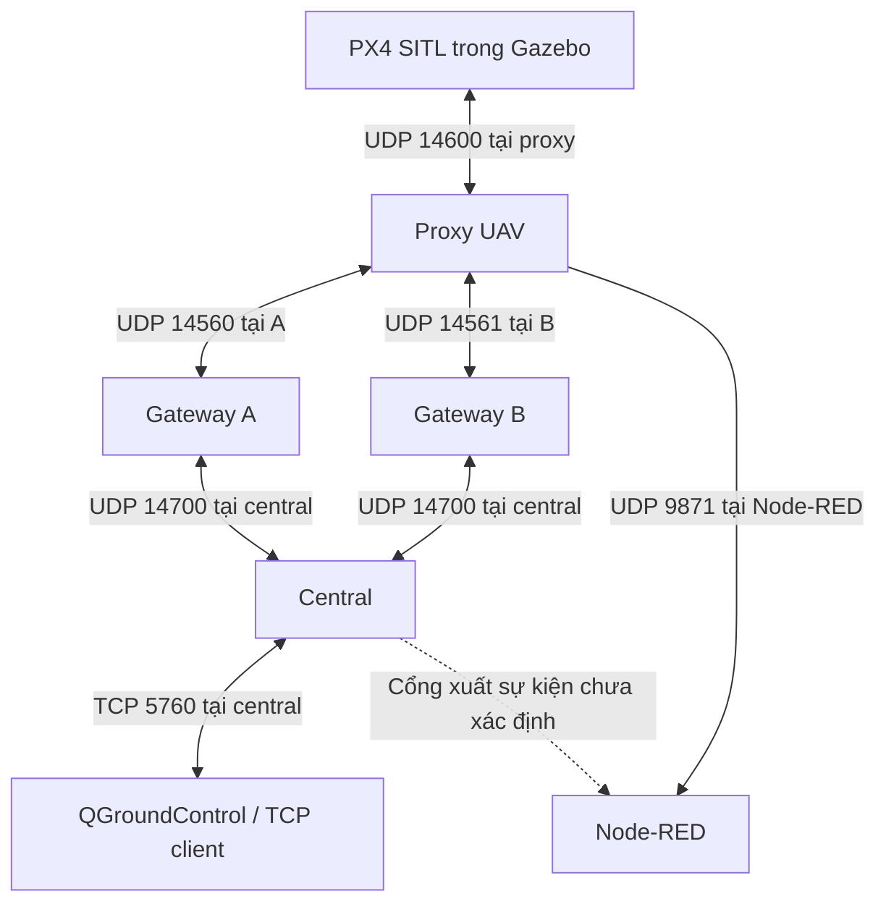

# PBL3project · MAVLink Gateway và chuyển vùng UAV PX4

PBL3project mô phỏng cách truyền telemetry và lệnh điều khiển giữa UAV PX4 SITL và trạm mặt đất khi UAV di chuyển qua hai vùng gateway A/B trong Gazebo. Proxy xử lý vị trí và trạng thái đường truyền phía UAV. Central quản lý tuyến theo SYSID, chọn gateway phục vụ và giữ kết nối với QGroundControl hoặc TCP client. Node-RED hiển thị vị trí, vùng phủ và số liệu đường truyền.

## Kiến trúc hệ thống



| Thành phần | Chức năng |
| --- | --- |
| PX4 SITL và Gazebo | Mô phỏng UAV, cập nhật trạng thái bay và phát bản tin MAVLink. |
| Proxy | Nhận và chuyển tiếp MAVLink hai chiều, theo dõi vị trí, áp dụng vùng phủ, đo chất lượng đường và thực thi chuyển gateway. |
| Gateway A/B | Chuyển tiếp giữa proxy và central, phản hồi probe và báo trạng thái. Hai tiến trình dùng chung chương trình gateway. |
| Central | Quản lý gateway và client, định tuyến theo SYSID, kiểm tra quyền điều khiển và quyết định chuyển tuyến. |
| QGroundControl / TCP client | Nhận telemetry qua central. Client được cấp quyền có thể gửi lệnh tới UAV đích. |
| Node-RED | Hiển thị UAV, vùng phủ, gateway đang dùng, RSSI mô phỏng, RTT và sự kiện chuyển vùng. |

### Giao thức và cổng kết nối

Bảng ghi cổng ở phía lắng nghe theo cấu hình thiết kế A/B.

| Kết nối | Giao thức | Cổng đích | Dữ liệu |
| --- | --- | --- | --- |
| PX4 → Proxy | UDP | 14600 tại proxy | Telemetry MAVLink. Chiều về dùng endpoint PX4 được proxy ghi nhận. |
| Proxy → Gateway A | UDP | 14560 tại A | MAVLink và probe trên đường A. |
| Proxy → Gateway B | UDP | 14561 tại B | MAVLink và probe trên đường B. |
| Gateway A/B → Central | UDP | 14700 tại central | Đăng ký, trạng thái đường, dữ liệu và yêu cầu điều phối. |
| QGC/TCP client → Central | TCP | 5760 tại central | Telemetry và lệnh đi hai chiều trên kết nối TCP do client mở. |
| Proxy → Node-RED | UDP | 9871 tại Node-RED | JSON giám sát vị trí và trạng thái. |
| Central → Node-RED | Chưa xác định | Chưa xác định | Luồng sự kiện dự kiến. |

Chiều trả lời UDP dùng endpoint nguồn đã ghi nhận hoặc endpoint đã đăng ký theo từng thành phần. Cổng nguồn có thể khác cổng đích trong bảng.

### Cổng vận hành bổ sung

| Kết nối hoặc thành phần | Giao thức | Cổng | Khi sử dụng |
| --- | --- | --- | --- |
| MAVLink instance của PX4 | UDP | 14611 tại PX4 | Cổng local trong ví dụ ở `docs/udp_proxy.md`. PX4 gửi từ instance này đến UDP 14600 của proxy. |
| Proxy → Gateway trực tiếp | UDP | 14550 tại gateway | Chế độ một gateway có sẵn. |
| QGC/TCP client → Gateway trực tiếp | TCP | 5760 tại gateway | Chế độ một gateway. Trong kiến trúc A/B, client kết nối TCP 5760 của central. |
| Trình duyệt → Node-RED | HTTP qua TCP | 1880 tại Node-RED | Cổng mặc định để mở editor và dashboard. Dữ liệu JSON từ proxy đi vào cổng UDP 9871. |

Khi gateway trực tiếp và central cùng chạy trên một máy, mỗi chương trình cần một cổng TCP lắng nghe riêng nếu chúng bind cùng địa chỉ.

## Cách hệ thống vận hành

1. **Nhận vị trí.** PX4 gửi telemetry tới proxy. Proxy đọc `LOCAL_POSITION_NED`, theo dõi tuổi mẫu theo SYSID và chuyển vị trí sang tọa độ world Gazebo để so sánh với tâm các vùng phủ.
2. **Xác định đường khả dụng.** Proxy tính khoảng cách ngang tới A và B. Mỗi vùng có bán kính 40 m. Gate áp dụng hai chiều cho từng đường proxy ↔ gateway. PX4 vẫn cập nhật vị trí cho proxy khi UAV ra ngoài cả hai vùng.
3. **Đo chất lượng.** Proxy tính RSSI mô phỏng theo khoảng cách 3D tới anten, đồng thời gửi probe qua các đường khả dụng. Gateway phản hồi probe để proxy tính RTT và số probe hết hạn.
4. **Truyền telemetry và lệnh.** Telemetry đi từ PX4 qua proxy, gateway đang phục vụ và central tới các client. Ở chiều ngược lại, central kiểm tra quyền, tra SYSID đích và chuyển lệnh qua tuyến đã xác nhận. Phản hồi MAVLink của PX4 đi trở lại client qua hệ thống.
5. **Chuyển gateway.** Trong vùng giao nhau, A và B có thể cùng khả dụng. Central chọn đường dựa trên độ mới của báo cáo, chất lượng đường và các ngưỡng chống chuyển qua lại. Proxy thực thi và xác nhận đường mới để central cập nhật bảng tuyến. Nếu đường hiện tại mất, central có thể phối hợp chuyển qua đường ứng viên còn khả dụng.
6. **Giám sát.** Node-RED nhận dữ liệu quan sát riêng. Giao diện hiển thị **vùng UAV đang ở** và **gateway đang phục vụ** thành hai thông tin riêng, cùng các sự kiện như mất đường, phục hồi và chuyển A → B.

### Mô hình vùng phủ và chất lượng đường

| Gateway | Tâm ngang (m) | Cao độ anten (m) | Bán kính ngang (m) |
| --- | --- | ---: | ---: |
| A | (0, 0) | 3,6 | 40 |
| B | (60, 0) | 3,6 | 40 |

- **Vùng phủ.** Một đường nằm trong vùng khi khoảng cách ngang từ UAV tới tâm trạm nhỏ hơn hoặc bằng 40 m.
- **RSSI mô phỏng.** Mô hình log-distance dùng khoảng cách 3D tới anten và các tham số suy hao. RSSI là dữ liệu đầu vào cho khảo sát chất lượng đường.
- **RTT.** Proxy lấy hiệu thời điểm nhận phản hồi và thời điểm gửi probe trên cùng đồng hồ monotonic. RTT này đại diện cho đường proxy ↔ gateway.
- **Chống chuyển qua lại.** Hysteresis yêu cầu ứng viên tốt hơn đường hiện tại một mức đủ lớn. Time-to-trigger yêu cầu điều kiện đó duy trì một khoảng thời gian. Khoảng giữ tuyến sau chuyển giúp hạn chế dao động khi UAV ở vùng giao nhau.

## Cấu trúc thư mục

Cây dưới đây mô tả thiết kế đầy đủ của hệ thống theo các thành phần A/B.

```text
PBL3project/
├── build.bat                             # Biên dịch các chương trình trên Windows
├── README.md                             # Tổng quan kiến trúc và vận hành
│
├── bin/
│   ├── udp_proxy.exe                     # Chạy proxy UAV
│   ├── gateway.exe                       # Chạy một phiên gateway A hoặc B
│   ├── central.exe                       # Chạy trung tâm định tuyến và handover
│   └── tcpclient.exe                     # Chạy client TCP trên terminal
│
├── src/
│   ├── common/
│   │   ├── config.h                      # Kiểu và thông số cấu hình dùng chung
│   │   ├── network.h                     # Hàm hỗ trợ socket Winsock
│   │   ├── mavlink_codec.h               # Giải mã và kiểm tra khung MAVLink
│   │   ├── sequence_tracker.h            # Theo dõi số thứ tự và khung thiếu
│   │   ├── time_utils.h                  # Hàm hỗ trợ thời gian và timeout
│   │   ├── qos.h                         # Chính sách chất lượng dịch vụ
│   │   └── envelope.h                    # Định dạng gói nội bộ
│   │
│   ├── proxy/
│   │   ├── udp_proxy.cpp                 # Điều phối vòng nhận/gửi, chuyển tiếp MAVLink hai chiều, gọi các module vị trí, vùng phủ, probe, handover và xuất dữ liệu quan sát
│   │   ├── position_tracker.h            # Lưu mẫu vị trí và vận tốc mới nhất theo UAV, tính tuổi mẫu và nhận diện dữ liệu quá hạn
│   │   ├── coordinate_transform.h        # Chuyển vị trí PX4 sang tọa độ world Gazebo để dùng chung hệ với các trạm
│   │   ├── coverage_model.h              # Tính khoảng cách ngang, xác định UAV trong A, B, vùng giao nhau hoặc ngoài cả hai
│   │   ├── coverage_gate.h               # Áp dụng quy tắc cho phép hoặc chặn telemetry, lệnh và probe trên từng đường
│   │   ├── rssi_model.h                  # Ước lượng RSSI mô phỏng riêng cho từng gateway
│   │   ├── link_monitor.h                # Đo RTT, phát hiện timeout và tổng hợp chất lượng theo từng đường
│   │   └── handover_executor.h           # Kiểm tra yêu cầu, đổi đường được chọn, xác nhận kết quả và xử lý yêu cầu đến muộn
│   │
│   ├── gateway/
│   │   ├── gateway.cpp                   # Điều phối chuyển tiếp tại gateway
│   │   ├── uav_manager.h                 # Theo dõi UAV và endpoint
│   │   ├── client_manager.h              # Quản lý client ở chế độ gateway trực tiếp
│   │   ├── statistics.h                  # Tổng hợp thống kê gateway
│   │   ├── probe_handler.h               # Nhận và phản hồi probe
│   │   └── central_link.h                # Trao đổi dữ liệu với central
│   │
│   ├── central/
│   │   ├── central.cpp                   # Điều phối nhận/gửi, gọi các bộ quản lý, chuyển telemetry tới client và định tuyến lệnh về gateway
│   │   ├── gateway_manager.h             # Quản lý đăng ký, theo dõi gateway còn hoạt động và báo cáo các đường ứng viên cho từng UAV
│   │   ├── route_table.h                 # Lưu tuyến đã xác nhận cho từng UAV
│   │   ├── handover_manager.h            # Đánh giá ứng viên, áp dụng hysteresis và thời gian duy trì, tạo yêu cầu chuyển và theo dõi kết quả
│   │   ├── client_manager.h              # Quản lý QGC/TCP client, phân phối telemetry, xử lý gửi từng phần và client chậm
│   │   └── control_policy.h              # Phân biệt client quan sát với client điều khiển, kiểm tra quyền và đích trước khi chuyển lệnh
│   │
│   └── client/
│       └── tcpclient.cpp                 # Nhận và hiển thị telemetry qua TCP
│
├── config/
│   ├── proxy.json                        # Endpoint PX4, gateway và Node-RED
│   ├── central.json                      # Cổng central, quyền và chính sách handover
│   ├── zones.json                        # Tâm trạm, cao độ và bán kính vùng
│   └── gateways/
│       ├── gateway_a.json                # Định danh và endpoint của A
│       └── gateway_b.json                # Định danh và endpoint của B
│
├── simulation/
│   └── worlds/
│       └── gateway_2zones_40m.sdf        # World Gazebo với hai vùng 40 m
│
├── dashboard/
│   └── node-red/
│       ├── flows.json                    # Flow nhận và phân phối dữ liệu Node-RED
│       └── uav_view.vue                  # Giao diện UAV và vùng phủ
│
├── scripts/
│   ├── build_udp_proxy.bat               # Biên dịch proxy
│   ├── run_px4.sh                        # Khởi chạy PX4 cùng world Gazebo
│   ├── start_ground.ps1                  # Khởi chạy các tiến trình mặt đất
│   └── stop_ground.ps1                   # Dừng các tiến trình mặt đất
│
├── logs/
├── tools/
├── tests/
├── docs/
│   └── ketqua/
└── third_party/
    └── mavlink/
```

## Chức năng từng file trong proxy

| File | Dữ liệu xử lý | Chức năng |
| --- | --- | --- |
| `udp_proxy.cpp` | Datagram UDP từ PX4 và gateway, trạng thái đường | Điều phối vòng nhận/gửi, chuyển tiếp MAVLink hai chiều, gọi các module vị trí, vùng phủ, probe, handover và xuất dữ liệu quan sát. |
| `position_tracker.h` | `LOCAL_POSITION_NED`, SYSID, thời điểm nhận | Lưu mẫu vị trí và vận tốc mới nhất theo UAV, tính tuổi mẫu và nhận diện dữ liệu quá hạn. |
| `coordinate_transform.h` | Tọa độ NED, hướng trục và độ lệch gốc | Chuyển vị trí PX4 sang tọa độ world Gazebo để dùng chung hệ với các trạm. |
| `coverage_model.h` | Tọa độ world, tâm và bán kính vùng | Tính khoảng cách ngang, xác định UAV trong A, B, vùng giao nhau hoặc ngoài cả hai. |
| `coverage_gate.h` | Kết quả vùng, gateway, chiều và loại gói | Áp dụng quy tắc cho phép hoặc chặn telemetry, lệnh và probe trên từng đường. |
| `rssi_model.h` | Khoảng cách 3D tới anten, tham số suy hao | Ước lượng RSSI mô phỏng riêng cho từng gateway. |
| `link_monitor.h` | Probe đang chờ, phản hồi và thời hạn | Đo RTT, phát hiện timeout và tổng hợp chất lượng theo từng đường. |
| `handover_executor.h` | Yêu cầu central, SYSID, phiên và tuyến hiện tại | Kiểm tra yêu cầu, đổi đường được chọn, xác nhận kết quả và xử lý yêu cầu đến muộn. |

## Chức năng từng file trong central

| File | Dữ liệu xử lý | Chức năng |
| --- | --- | --- |
| `central.cpp` | Dữ liệu gateway, kết nối client, sự kiện và timeout | Điều phối nhận/gửi, gọi các bộ quản lý, chuyển telemetry tới client và định tuyến lệnh về gateway. |
| `gateway_manager.h` | Gateway ID, endpoint, phiên và heartbeat | Quản lý đăng ký, theo dõi gateway còn hoạt động và báo cáo các đường ứng viên cho từng UAV. |
| `route_table.h` | SYSID, gateway phục vụ, phiên và trạng thái tuyến | Lưu tuyến đã xác nhận cho từng UAV. Cung cấp tuyến chiều về và cập nhật khi chuyển vùng được xác nhận. |
| `handover_manager.h` | Trạng thái vùng, RSSI, RTT, mất probe và tuyến hiện tại | Đánh giá ứng viên, áp dụng hysteresis và thời gian duy trì, tạo yêu cầu chuyển và theo dõi kết quả. |
| `client_manager.h` | Kết nối và luồng TCP, hàng đợi từng client | Quản lý QGC/TCP client, phân phối telemetry, xử lý gửi từng phần và client chậm. |
| `control_policy.h` | Quyền client, nhóm lệnh và SYSID đích | Phân biệt client quan sát với client điều khiển, kiểm tra quyền và đích trước khi chuyển lệnh. |

## Các nhóm còn lại

| Nhóm | Chức năng |
| --- | --- |
| `src/common/` | Dùng chung kiểu cấu hình, xử lý socket, parser MAVLink, sequence, thời gian, QoS và định dạng gói nội bộ. |
| `src/gateway/` | Nhận/chuyển tiếp MAVLink, quản lý đầu cuối UAV hoặc proxy, trả lời probe, giao tiếp với central và ghi thống kê. `client_manager.h` hỗ trợ luồng dùng gateway trực tiếp. |
| `src/client/` | TCP client theo dõi telemetry trên terminal. |
| `config/` | Mô tả endpoint proxy, central, gateway A/B và hình học vùng phủ. |
| `simulation/` và `dashboard/` | Chứa world Gazebo, flow Node-RED và giao diện giám sát. |
| `scripts/`, `tools/`, `tests/` | Hỗ trợ build, vận hành, khảo sát và kiểm tra chức năng. |
| `logs/` và `docs/ketqua/` | Lưu log vận hành và kết quả khảo sát. |
| `third_party/mavlink/` | Thư viện MAVLink dùng để giải mã và kiểm tra khung dữ liệu. |
