# Báo cáo đo lại Gateway với kênh Markov

## Phạm vi và nguyên tắc đọc số liệu

Đây là **kết quả Gateway**, còn client chỉ làm công cụ phát lệnh/kiểm tra khóa. Các kết quả K1–K7 đến từ PX4 SITL thật, trừ K0 dùng gói tổng hợp và K6 dùng UAV giả chỉ để trả ACK cho lệnh ARM. K8 tạm dừng PX4 SITL để đo timeout. Không trộn kết quả A1/B5/B10 cũ vào báo cáo này.

Theo thay đổi yêu cầu trong lúc đo: K1–K2 có **3 lượt × 120 s**; từ K3 có **2 lượt × 60 s**; mỗi lượt có 5 s ổn định trước cửa sổ ghi số. Số trong bảng viết dạng **trung bình ± độ lệch chuẩn mẫu** của số lượt thực tế, không ghi nhầm K3–K7 thành 3 lượt. Mức loss đặt là xác suất dừng của mô hình, còn loss thực tế là số gói bị thả trong từng lượt hữu hạn. Với tỷ lệ đúng bằng 0, sai số tương đối không xác định; dùng chênh lệch tuyệt đối theo điểm phần trăm.

## B1–B4. Môi trường và hệ thống

B1 đầy đủ kèm nguồn xác minh có tại [moi_truong_do_K.md](moi_truong_do_K.md). Tóm tắt: Windows 11 Pro build 26200; CPU i5-12450H, RAM 16,78 GB; WSL 3.0.5 với Ubuntu 24.04/WSL2 NAT; Windows `172.26.160.1`, WSL `172.26.162.42`; PX4 SITL 1.18.0 80; Gazebo Sim 8.15.0, model x500, có GUI. PX4, Gazebo, proxy và gateway cùng máy nên có jitter nền.

**B2. Tham số triển khai**

| Tham số | Giá trị |
|---|---|
| PX4 MAVLink | UDP local 14600 → Windows 14550; Normal, tối đa 100.000 B/s; HEARTBEAT 1 Hz, ATTITUDE yêu cầu 10 Hz |
| Gateway | UDP 14550 trực tiếp hoặc 14551 sau proxy; TCP 5760 |
| Proxy | UDP 14550 từ PX4, nguồn sang gateway 14610, chiều ngược trở lại PX4 |
| UAV timeout | 3 s; vòng `select` tối đa 200 ms |
| Client | `SUBSCRIBE` 1–5 Hz; tối đa 10 client; hàng đợi TCP 256 KiB/client |
| Build | MinGW GCC 6.3.0, `-O2 -std=c++17`; pymavlink 2.4.50 |
| Markov K2/K4 | Theo frame: `r=0,25`; `p=0,013158` hoặc `0,027778`; tốt giữ hết, xấu thả hết |
| Markov K3 | Theo frame: `r=1`; `p=0,052632`; cùng loss đặt 5% với K2 |

**B3. MAVLink được giải mã/dùng cho chức năng**

| Message | ID | CRC_EXTRA | Vai trò |
|---|---:|---:|---|
| HEARTBEAT | 0 | 50 | Online, mode, armed; gateway gửi GCS 1 Hz |
| SYS_STATUS | 1 | 124 | Pin, dòng, điện áp |
| GPS_RAW_INT | 24 | 24 | GPS fix, vệ tinh |
| ATTITUDE | 30 | 39 | Góc và đo jitter nhận |
| GLOBAL_POSITION_INT | 33 | 104 | Vị trí, độ cao, heading |
| VFR_HUD | 74 | 20 | Tốc độ, throttle |
| COMMAND_LONG | 76 | 152 | ARM/TAKEOFF/LAND từ gateway |
| COMMAND_ACK | 77 | 143 | Kết quả lệnh |

**B4. Giao thức TCP client ↔ gateway**

| Lệnh | Phản hồi chính | Lỗi thường gặp |
|---|---|---|
| `GET_DETAIL [sysid]` | `DETAIL {...}` hoặc `DETAIL NONE` | `ERR USAGE` |
| `SUBSCRIBE 1..5` / `UNSUBSCRIBE` | `OK SUBSCRIBE n` / `OK UNSUBSCRIBE` | `ERR USAGE` |
| `ACQUIRE` / `RELEASE` | `OK ACQUIRE` / `OK RELEASE` | `ERR LOCKED`, `ERR NOT_OWNER` |
| `COMMAND sysid ARM\|DISARM\|TAKEOFF\|LAND [altitude_m]` | `OK COMMAND_PENDING`, sau đó `RESULT` khi ACK/timeout | `ERR NOT_OWNER`, `ERR UAV_OFFLINE`, `ERR COMMAND_BUSY`, `ERR ALTITUDE` |
| MAVLink `MISSION_REQUEST_LIST`, `MISSION_REQUEST_INT`, `MISSION_REQUEST`, `MISSION_ACK` | Chuyển tiếp yêu cầu đọc nhiệm vụ; PX4 trả `MISSION_COUNT`/mục nhiệm vụ qua luồng chiều về | Bị chặn nếu UAV đích offline |
| MAVLink `MANUAL_CONTROL` | Chuyển tiếp joystick đến `target` khi QGC/MAVLink client đang giữ khóa, hoặc text client đã `ACQUIRE` | Bị chặn khi client khác giữ khóa hoặc `target=0` |
| MAVLink `SET_MODE` (11) | Chuyển tiếp đổi chế độ bay của QGC | Bị chặn khi client khác giữ khóa hoặc `target=0` |
| MAVLink `COMMAND_LONG`/`COMMAND_INT` cho mã `21`, `22`, `176`, `400` | Chuyển tiếp ARM/DISARM/TAKEOFF/LAND/đổi mode của QGC; kết nối MAVLink tự giữ khóa ở lệnh điều khiển đầu tiên | Bị chặn khi client khác giữ khóa hoặc `target=0` |
| MAVLink `COMMAND_LONG`/`COMMAND_INT` cho mã `401`, `510`, `511`, `512`, `519`, `520` | Chuyển tiếp kiểm tra trước bay, yêu cầu thông tin và tần suất telemetry của QGC | Bị chặn nếu không có đường tới UAV |
| MAVLink `REQUEST_EVENT`, `PARAM_EXT_REQUEST_READ/LIST`, `TIMESYNC` | Chuyển tiếp yêu cầu sự kiện và dữ liệu đọc của QGC | Bị chặn nếu không có đường tới UAV |

Các dòng MAVLink được thêm sau đợt đo K0–K8. Phép kiểm tra với UAV giả trong `tests/test_qgc_control.py` xác nhận QGC nhận telemetry, chuyển tiếp được `ARM`, `TAKEOFF`, `SET_MODE` và `MANUAL_CONTROL`, client thứ hai bị khóa và đóng QGC thì nhả khóa. Chưa đo joystick/ARM/TAKEOFF với PX4 bay thật.

## B5–B8. Kiểm định thành phần

**B5. Parse/CRC.** [D1 mới](D/D1/20261114_174817/result.csv) đạt 2/2 bộ test: 200 frame MAVLink v1/v2 hợp lệ, 88/88 phép lật bit phát hiện CRC, dữ liệu rác và 10.000 frame liên tiếp không làm parser lỗi. [D2 mới](D/D2/20261114_181136/result.csv) xác nhận gateway nhận frame hợp lệ và đếm đúng 1 lỗi CRC khi lật bit trên UDP. K7 bên dưới kiểm tra CRC với luồng PX4 thật. Kết quả không chứng minh parser đúng với mọi frame ngoài tập đã thử.

**B6. Đối chiếu pymavlink.** [Probe độc lập 5 s sau khi phục hồi PX4](K8/20261114_180053/restore_probe.csv) nhận 244 frame hợp lệ, gồm 4 HEARTBEAT và 45 ATTITUDE, từ `172.26.162.42:14600`, tương ứng 48,8 frame/s và 9 ATTITUDE/s. Gateway K1 nhận trung bình 51,367 frame/s và 9,167 ATTITUDE/s. Hai cửa sổ **không đồng thời**, nên đây chỉ là đối chiếu tần số gần đúng; không tính “sai số gateway so với pymavlink” trên cùng tập frame. Cần bộ thu song song hoặc lưu raw datagram để có B6 định lượng chặt chẽ.

**B7. Logic sequence.** [11 điều kiện kiểm tra mới](F/sequence/20261114_174803/result.csv) đều PASS: liên tục, mất 1, mất cụm 5, quay vòng 255→0, trùng, đảo đến muộn, restart và im lặng dài. Chưa có kiểm thử jitter bằng timestamp giả riêng; K1/K5 kiểm tra jitter trên luồng thực bằng QueryPerformanceCounter.

**B8. K0, 100.000 gói tổng hợp/lượt, 3 seed mỗi cấu hình** — [CSV từng lượt](K0/20261114_172116/result.csv), [tổng hợp](K0/20261114_172116/summary.csv).

| Cấu hình | Loss đặt | Loss thực tế | Cụm đặt | Cụm thực tế |
|---|---:|---:|---:|---:|
| Không thả | 0% | 0% | — | — |
| K2 | 5% | 4,850 ± 0,279% | 4 gói | 3,947 ± 0,090 gói |
| K3 | 5% | 5,042 ± 0,023% | 1 gói | 1,000 ± 0 gói |
| K4 | 10% | 9,869 ± 0,257% | 4 gói | 3,904 ± 0,046 gói |

Tất cả 12 lượt tổng hợp tái lập cùng quyết định gói khi dùng lại seed. Sai số tương đối của loss trung bình so với mức đặt lần lượt K2 3,00%, K3 0,83%, K4 1,31%. K0 kiểm định **bộ sinh lỗi**, chưa phải hiệu năng truyền thông PX4.

## B9–B11. QoS và CRC trên PX4 SITL

**B9. Baseline K1** — [CSV 3 lượt](K1/summary.csv).

| Frame/s | ATTITUDE/s | Seq loss | Jitter ATTITUDE std | Jitter max | CRC | Offline |
|---:|---:|---:|---:|---:|---:|---:|
| 51,367 ± 0,055 | 9,167 ± 0,017 | 0% | 1,801 ± 0,154 ms | 21,728 ± 15,789 ms | 0 | 0 |

**B10. So sánh proxy ↔ gateway** — số liệu theo cửa sổ riêng của từng bộ ghi; K3/K4 còn có file `common.csv` để kiểm tra khoảng thời gian giao nhau.

| Bài | Lượt × giây | Loss proxy lên | Loss gateway | Cụm proxy TB | Cụm gateway TB | Jitter ATTITUDE std | CRC |
|---|---:|---:|---:|---:|---:|---:|---:|
| K1 | 3 × 120 | — | 0% | — | — | 1,801 ± 0,154 ms | 0 |
| K2 | 3 × 120 | 4,701 ± 0,872% | 4,892 ± 0,955% | 4,298 ± 0,326 | 4,555 ± 0,873 | 2,545 ± 1,086 ms | 0 |
| K3 | 2 × 60 | 4,312 ± 0,320% | 4,312 ± 0,274% | 1,000 ± 0 | 1,000 ± 0 | 2,847 ± 0,023 ms | 0 |
| K4 | 2 × 60 | 10,219 ± 0,876% | 10,029 ± 0,511% | 4,477 ± 0,426 | 4,412 ± 0,334 | 4,102 ± 2,403 ms | 0 |
| K5 | 2 × 60 | 0% | 0% sau sửa gói đảo thứ tự | — | — | 13,242 ± 1,319 ms | 0 |

K3/K4 chung cửa sổ: [K3 lượt 1](K3/20261114_175046_r1/common.csv) 4,542% proxy so với 4,541% gateway; [K3 lượt 2](K3/20261114_175154_r2/common.csv) 4,110% so với 4,111%; [K4 lượt 1](K4/20261114_175329_r1/common.csv) đều 9,671%; [K4 lượt 2](K4/20261114_175438_r2/common.csv) đều 10,279%. K2 được đo trước khi thêm trace có mốc chung; sai khác trung bình 0,191 điểm phần trăm phải đọc cùng log gốc. K2 có 1 lượt offline; K3/K4 không offline.

K5 có 398 ± 88 frame/lượt được xếp hàng delay ở chiều lên; trung bình delay **đặt** 49,757 ± 0,585 ms, trung bình delay **quan sát** 56,592 ± 0,399 ms. Jitter ATTITUDE tăng khoảng 7,35 lần so với K1. Các bước nhảy sequence tạm thời do gói đến đảo thứ tự **không phải loss cuối cùng**; bộ theo dõi sửa lại thành 0 gói mất. Độ lệch giữa delay đặt/quan sát có phần do lịch trình Windows và vòng `select`.

**B11. K7 lật bit 2%** — [CSV 2 lượt](K7/summary.csv).

| Lượt | Proxy đã lật và gửi | Gateway CRC lỗi | Chênh lệch |
|---|---:|---:|---:|
| 1 | 65 | 64 | 1 |
| 2 | 51 | 51 | 0 |
| Trung bình | 58,0 ± 9,9 | 57,5 ± 9,2 | 0,5 gói |

K7 proxy không thả Markov; sequence gap gateway trung bình 1,828 ± 0,293% đến từ frame sai CRC bị loại. Sai khác 1 frame ở lượt 1 có thể do cửa sổ proxy/gateway bắt đầu khác nhau; không gọi đây là một frame gateway “lọt CRC” khi chưa ghép timestamp chính xác.

## B12–B14. Chức năng Gateway và ACK/retry

**B12. TCP/điều khiển.** [Kiểm tra đa client mới](F/gateway_functions/20261114_181251/checks.csv) đạt 13/13 điều kiện: 3 client cùng nhận `DETAIL`, gửi TCP từng byte, hai lệnh dính nhau, lệnh sai định dạng, một client không đọc trong thời gian ngắn mà client khác vẫn được phục vụ. [E2 mới](E/E2/20261114_181150/checks.csv) đạt 7/7 điều kiện ARM, retry, GCS HEARTBEAT và ACK/RESULT. [Chuỗi ARM → TAKEOFF → LAND → DISARM](F/flight_commands/20261114_181756/result.csv) PASS với UAV giả trả ACK; ACK trùng không tạo thêm `RESULT`, lệnh khi UAV offline bị từ chối. [Kiểm thử ACK muộn](F/late_ack/20261114_1822/result.csv) xác nhận gateway đã trả `TIMEOUT` thì ACK đến sau không tạo thêm `RESULT`. Gateway đóng gói đúng `COMMAND_LONG` và trả kết quả về client giữ quyền. Đây là kiểm thử chức năng gateway, không phải số đo tốc độ client. Chưa thử client không đọc đủ lâu để đầy hàng đợi và thao tác TAKEOFF/LAND trên PX4 thật.

**B13. Khóa quyền.** [E1 mới](E/E1/20261114_181146/checks.csv) đạt 4/4 điều kiện: A lấy quyền, B bị từ chối, B không được gửi ARM, A ngắt thì B lấy được. [Kiểm tra mới](F/gateway_functions/20261114_181251/result.csv) cho 100/100 lần A và B xin quyền đồng thời có đúng một client thắng, và quyền được nhả khi client giữ quyền ngắt kết nối.

**B14. K6 lệnh qua Markov.** K6 dùng UAV giả để ACK cho 50 lệnh ARM mỗi lượt, 2 lượt mỗi mức loss. `success_pct = ACK thành công/50`, `retry_mean_per_command = số lần gửi lại/50`. Lệnh bị từ chối khi UAV OFFLINE được tính thất bại, nhưng không được tính là retry.

| Loss đặt hai chiều | Số lệnh/mức | ACK thành công | Retry trung bình/lệnh | Loss thực chiều Gateway → UAV giả |
|---|---:|---:|---:|---:|
| [0%](K6/L0/summary.csv) | 2 × 50 | 100 ± 0% | 0 ± 0 | 0% |
| [5%](K6/L5/summary.csv) | 2 × 50 | 96,0 ± 5,7% | 0,080 ± 0,057 | 2,812 ± 1,120% |
| [10%](K6/L10/summary.csv) | 2 × 50 | 100 ± 0% | 0,160 ± 0,057 | 9,992 ± 9,033% |

Ở mức 5%, một lượt 50/50 và một lượt 46/50; bốn lệnh đầu của lượt sau bị `ERR UAV_OFFLINE` vì heartbeat giả bị mất trước khi gửi lệnh. Ở mức 10%, cả hai lượt 50/50 dù số retry tăng. **Không** suy ra loss 10% làm lệnh tin cậy hơn loss 5%: chỉ có hai lượt, loss thực chiều ngược dao động từ 3,604% đến 16,379%, và thành công còn phụ thuộc thời điểm mất heartbeat/ACK. [CSV từng lệnh](K6/L5/20261114_180554_r2/commands.csv) cho thấy rõ các trường hợp OFFLINE.

**Phát hiện timeout K8.** [Kết quả](K8/20261114_180053/result.csv) ghi gateway báo OFFLINE 3,163 s sau lệnh tạm dừng PX4, phù hợp ngưỡng cấu hình 3 s và chu kỳ xử lý. Phép đo này dùng `SIGSTOP` và `SIGCONT`, không phải tắt nguồn UAV. Sau `SIGCONT`, PX4 từng ở trạng thái terminal stop `T`; [restore.log](K8/20261114_180053/restore.log) ghi lại trạng thái đó. Sau khi đưa tiến trình về foreground, [probe phục hồi](K8/20261114_180053/restore_probe.csv) nhận 244 frame MAVLink hợp lệ trong 5 s từ PX4, nên xác nhận PX4 đã phát lại telemetry đến Windows:14550. Gateway không chạy trong phép probe này; trạng thái `rx: 0.0 B/s` ở PX4 không phải lỗi của đường PX4 → Windows.

## B15. Hạn chế và nguồn sai số

| Nguồn | Ảnh hưởng | Cách đọc kết quả |
|---|---|---|
| Cửa sổ gateway/proxy bắt đầu độc lập | Loss tổng 60/120 s có thể khác nhau | Dùng `common.csv` ở K3/K4; K2 chỉ so sánh gần đúng |
| Số lượt K3–K7 chỉ 2 | Độ lệch chuẩn còn không ổn định | Không khẳng định phân bố dài hạn hay khoảng tin cậy hẹp |
| Chiều ngược chỉ khoảng 1 HEARTBEAT/s | 1 datagram làm phần trăm đổi đáng kể | Báo cả số thả/mẫu số trong từng `result.csv` |
| Proxy tách frame MAVLink thành UDP riêng | Có thể thay đổi tải datagram so với đường trực tiếp | So sánh sequence với proxy và giữ log; không quy mọi sai khác cho Markov |
| K5 reordering | Gap tức thời khác loss cuối cùng | Dùng `seq_gap_estimate` sau sửa gói đảo thứ tự |
| K7 khác mốc đo | 1 frame chênh CRC ở lượt 1 | Ghép trace trước khi kết luận lỗi parser |
| K6 dùng ACK từ UAV giả | Đo logic retry gateway, không đo thành công bay thật | Tách kết luận điều khiển logic và chuyến bay PX4 |
| PX4/Gazebo/gateway cùng máy | Jitter nền và lịch trình Windows/WSL | K1 là mốc nền; không suy jitter mạng một chiều từ inter-arrival |

**Độ phức tạp từ mã nguồn.** Một quyết định Markov theo frame cần `O(1)` thời gian và bộ nhớ; theo slot thời gian K5 cần `O(S)` cho `S` slot đã trôi qua. Parse MAVLink và CRC cần `O(L)` với `L` byte/frame. Theo dõi sequence dùng cửa sổ tối đa 128 vị trí, nên bộ nhớ `O(1)` theo độ dài bài đo; thao tác map trong cửa sổ là `O(log 128)`. Phân phối một frame cho `C` client cần `O(C·L)` sao chép vào các hàng đợi; khóa điều khiển là `O(1)`; tra ACK trong `std::map` là `O(log P)` với `P` lệnh chờ. Đây là **phân tích thuật toán**, chưa có phép đo CPU/RAM riêng để kết luận chi phí xử lý thực tế.

## H1–H6. Biểu đồ từ CSV

Tạo lại bằng `python -B scripts/plot_k_results.py`.

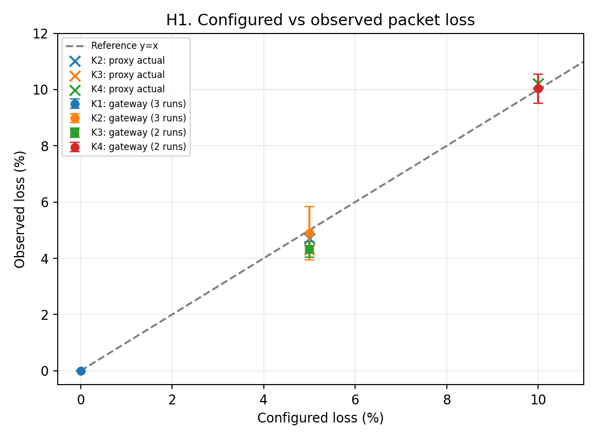

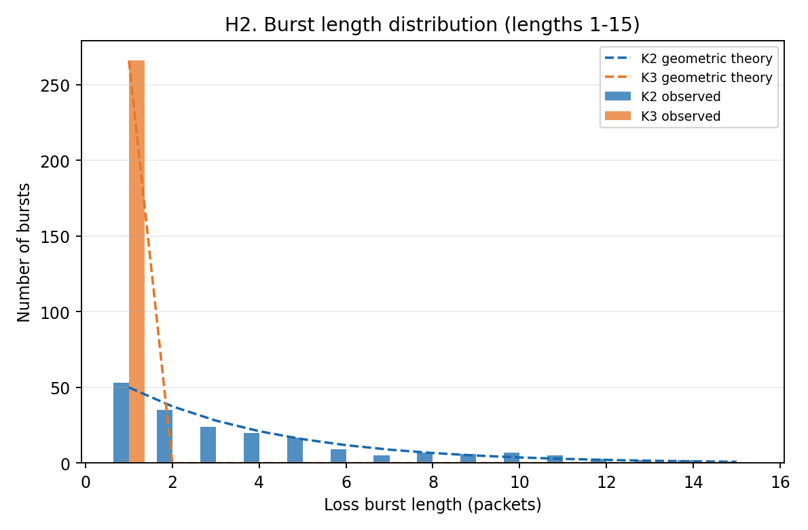

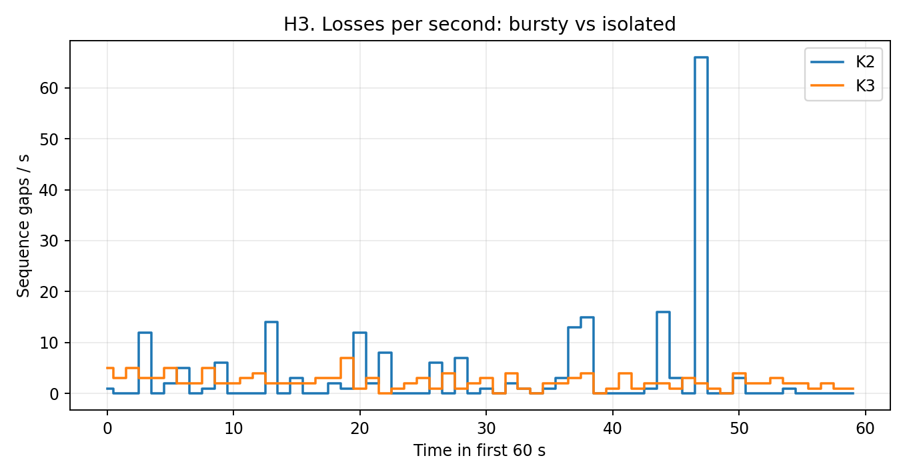

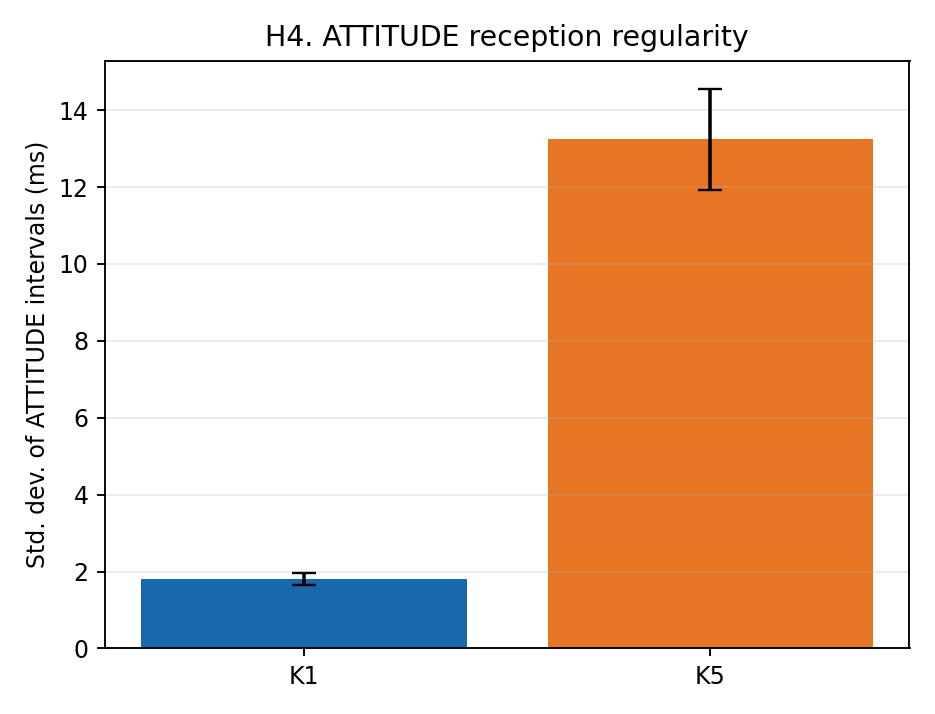

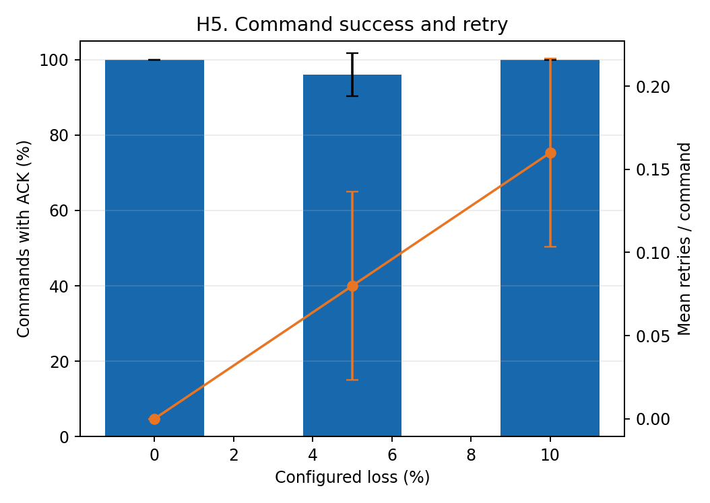

H6: [pps baseline](charts/H6_pps.png).

## S1–S6. Sơ đồ chức năng

**S1 — Kiến trúc đo**

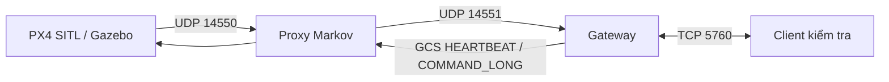

**S2 — MAVLink v2 và CRC**

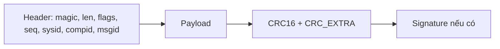

**S3 — Gilbert–Elliott**

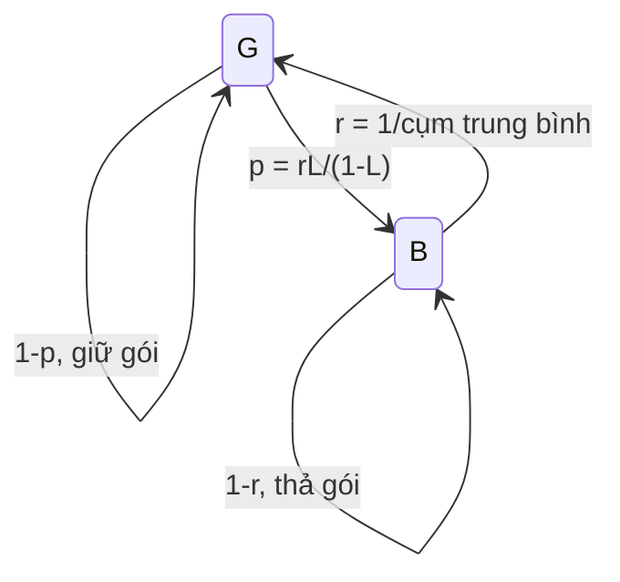

**S4 — Luồng xử lý gateway**

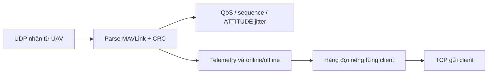

**S5 — ACK và retry**

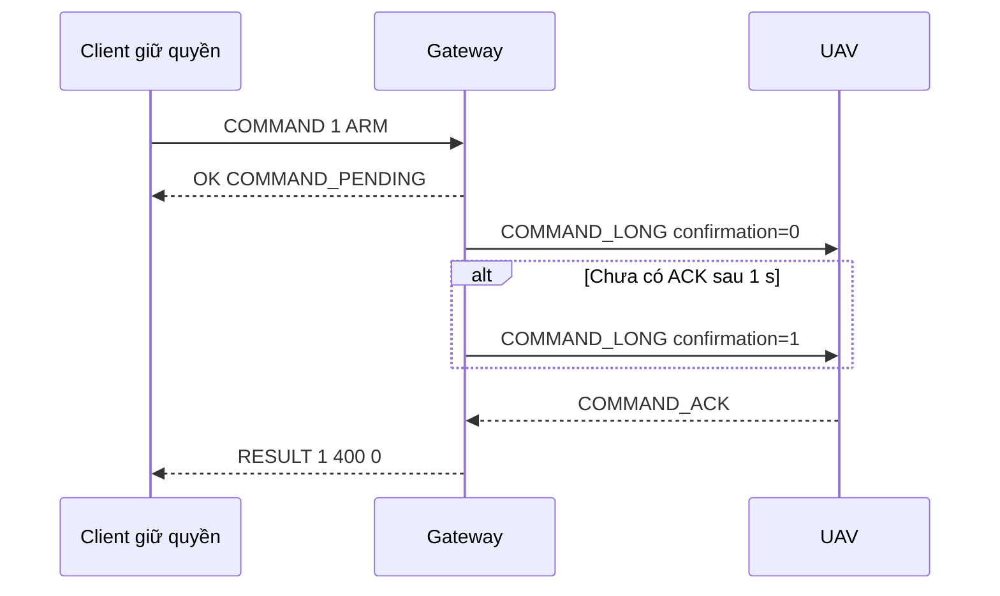

**S6 — Khóa điều khiển**

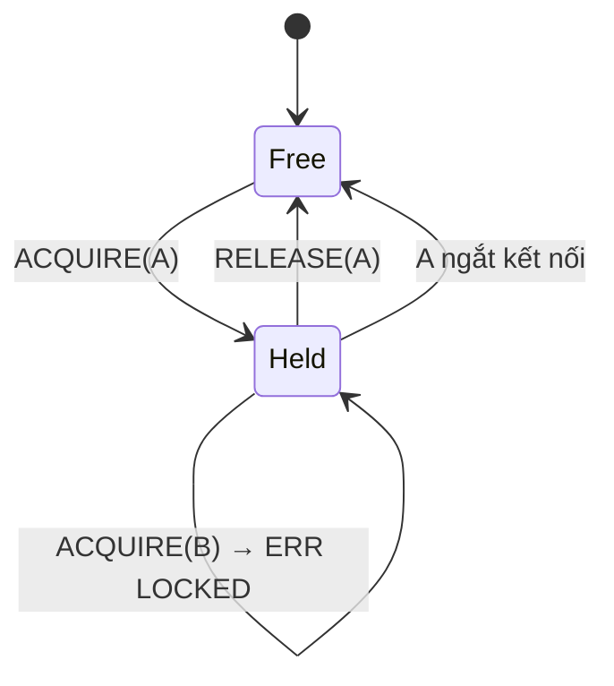

## Kết luận trong phạm vi đã đo

K0 xác nhận bộ sinh Markov tạo được tỷ lệ mất dài hạn và cụm mất theo cấu hình khi lấy 100.000 gói/lượt. K1 cho mốc trực tiếp không mất sequence; K2/K3 cùng mức loss nhưng độ dài cụm khác nhau rõ; K4 tạo khoảng 10% loss; K5 làm jitter ATTITUDE tăng; K7 làm gateway loại frame sai CRC. K6 cho thấy retry tăng từ 0 lên 0,16 lần/lệnh khi mức loss đặt tăng trong các lượt đã thử; kết quả ACK dùng UAV giả. Sau K8, probe pymavlink xác nhận PX4 phát lại telemetry đến Windows.
